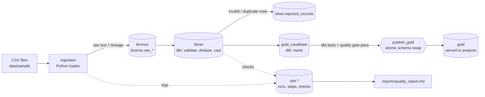

# Architecture

## Layers

| Layer | Schema | Contents | Rule |
|---|---|---|---|
| Bronze | `bronze` | Every source row as text, plus `_file_id`, `_row_number`, `_ingested_at` | Append-only. Never updated or overwritten. |
| Silver | `silver` | Typed, validated, de-duplicated entities; `rejected_records` quarantine | Rebuilt from Bronze on every run. |
| Gold | `gold` | Facts, dimensions and metric tables | Built in `gold_candidate`, published only after all gates pass. |
| Ops | `ops` | Runs, steps, file log, quality checks, publications | Metadata only. |

## Flow of one run

1. `check_sources` - every expected file exists and is not empty (critical).
2. `ingest` - each file is hashed; unseen content is loaded to Bronze in one transaction.
3. `validate_bronze` - file-level and malformed-row checks, recorded in `ops.quality_checks`.
4. `dbt_silver_run` / `dbt_silver_test` - build and test Silver.
5. `validate_silver` - valid / duplicate / invalid shares per entity.
6. `dbt_gold_run` / `dbt_gold_test` - build and test Gold in `gold_candidate`.
7. `publish_gold` - rename `gold_candidate` to `gold` inside one transaction.
8. `record_success` / `record_failure` - close the run and write the report.

## Key decisions

- **Python + SQL split.** Python does what SQL is poor at (file hashing, encoding, CSV structure, orchestration);
  dbt/SQL does the business logic, where it is reviewable and testable as data.
- **Bronze is text.** A bad value can never fail a load; it becomes a counted, explained rejection in Silver.
- **Idempotency by content hash.** The same file content is loaded once. A changed file is a new batch and Silver
  keeps the latest version of each key. Silver and Gold are rebuilt from scratch, so reruns cannot double-count.
- **Atomic publication.** DDL is transactional in PostgreSQL, so readers see the old or the new Gold, never a mix.
  Dropping the old Gold after the swap is safe because it is derived data.
- **Quarantine, not deletion.** Rejected rows stay visible with a reason in `silver.rejected_records`.
- **No pandas/Polars.** The loader streams rows with `COPY` and the transformations are SQL. The data is small and
  adding a dataframe library would not improve anything here.
- **dbt in its own virtualenv in Docker** to avoid dependency conflicts with Airflow.
- **Indexes are few on purpose.** Tables are small; only `_file_id` (lineage), `run_id` (reports) and the
  idempotency unique index exist. Add key indexes when volumes justify them.
